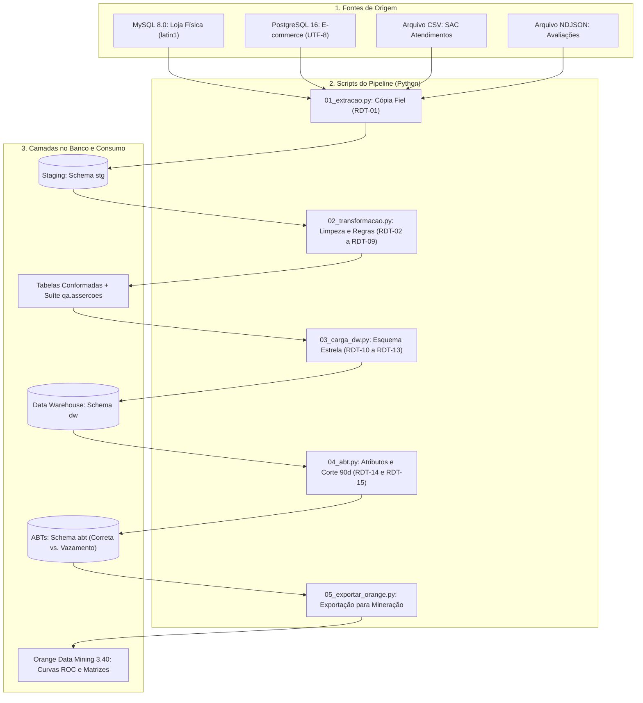

# DOCUMENTAÇÃO TÉCNICA E ARQUITETURAL DO PIPELINE DE DADOS
## Projeto Mercatto Varejo: Engenharia de DW, Qualidade de Dados e Mineração Preditiva

**Instituição:** Instituto Federal de Educação, Ciência e Tecnologia de Mato Grosso (IFMT)  
**Disciplina:** Mineração de Dados (Semestre 2026/2)  
**Docente Responsável:** Prof. Dr. Orlando Júnior  
**Stack Tecnológica:** Docker Compose, PostgreSQL 16 (DW e E-commerce), MySQL 8.0 (Legado), Python 3.12 (Pandas, SQLAlchemy), Orange Data Mining 3.40  
**Fichas Completas dos RDTs:** [docs/MODELO_RDT_preenchido.md](file:///home/spacery/Documents/[CodeRoot]/IFMT/Mineração de Dados/Mineracao-de-dados-pratica-ETL/docs/MODELO_RDT_preenchido.md)

---

## Resumo em 1 Minuto (Visão Geral)

* **O Problema:** A Mercatto Varejo uniu suas lojas físicas (MySQL antigo) com seu e-commerce (PostgreSQL), além de planilhas do SAC (CSV) e avaliações de clientes (NDJSON). Os sistemas usavam formatos, moedas contábeis e regras de cancelamento incompatíveis.
* **O Volume:** **2,2 milhões de linhas** processadas em lotes (`ESCALA=1.0`), resultando em **106.937 clientes unificados**, **410.000 pedidos** e **1.371.876 itens de pedido** no Data Warehouse.
* **A Qualidade:** **127 verificações automáticas (`qa.assercoes`)** monitoram todas as etapas com **100% de aprovação** e desvio financeiro de **0,00%** em relação às origens.
* **A Descoberta no Orange (Semana 4):** Em uma base de **99.749 clientes reais** (taxa de recompra de **21,77%**), provamos como um erro de vazamento de dados faz modelos comuns saltarem de uma AUC realista (**0,50–0,54**) para uma precisão ilusória (**0,80–0,89** e **90,2% de acurácia**) que falharia em produção.
* **A Performance:** O pipeline completo roda do zero em **2 minutos e 50 segundos** via Docker.

### Sumário Navegável
1. [Visão Geral e Arquitetura de Dados](#1-visão-geral-e-arquitetura-de-dados)
2. [Etapa 1: Extração Bruta e Área de Staging (`01_extracao.py`)](#2-etapa-1-extração-bruta-e-área-de-staging-01_extracaopy--rdt-01)
3. [Etapa 2: Transformação e Saneamento (`02_transformacao.py`)](#3-etapa-2-transformação-e-saneamento-02_transformacaopy--rdt-02-a-rdt-09)
4. [Etapa 3: Modelagem Dimensional e Carga no DW (`03_carga_dw.py`)](#4-etapa-3-modelagem-dimensional-e-carga-no-dw-03_carga_dwpy--rdt-10-a-rdt-13)
5. [Etapa 4: Engenharia de Atributos e Construção das ABTs (`04_abt.py`)](#5-etapa-4-engenharia-de-atributos-e-construção-das-abts-04_abtpy--rdt-14-e-rdt-15)
6. [Etapa 5: Mineração de Dados e Avaliação no Orange (`05_exportar_orange.py`)](#6-etapa-5-mineração-de-dados-e-avaliação-no-orange-05_exportar_orangepy--orange-340)
7. [Verificação Operacional e Comandos de Execução](#7-verificação-operacional-e-comandos-de-execução)
8. [Guia Rápido de Respostas para a Apresentação (FAQ)](#8-guia-rápido-de-respostas-para-a-apresentação-faq)
9. [Auditoria de Performance e Otimizações Recentes](#9-auditoria-de-performance-e-otimizações-recentes)

---

## 1. VISÃO GERAL E ARQUITETURA DE DADOS

### 1.1. As Quatro Fontes de Dados
A rede Mercatto Varejo opera com quatro fontes que nasceram em épocas e tecnologias diferentes:

1. **Loja Física (Legado — MySQL 8.0):** Sistema dos anos 2000 em codificação `latin1`, tabelas em caixa alta (`CLIENTES`, `PEDIDOS`, `ITENS_PEDIDO`, `PRODUTOS`), categorias em texto livre e uso de números negativos ou datas em `1900-01-01` para indicar ausência de valor.
2. **Loja Virtual (E-commerce — PostgreSQL 16):** Sistema moderno em `UTF-8` (`shop.customer`, `orders`, `order_item`, `product`, `category`), com datas em fuso horário (`TIMESTAMPTZ`) e categorias organizadas em árvore.
3. **Chamados do SAC (CSV):** Arquivo `atendimentos_sac.csv` separado por `;`, codificado em `latin1`, contendo quebras de linha dentro dos textos de reclamação.
4. **Avaliações de Produtos (NDJSON):** Arquivo `avaliacoes.ndjson` onde cada linha é um JSON independente, com notas ora escritas como número (`5`), ora como texto (`"5"`), e produtos físicos mascarados como `LEG-{id}`.

---

### 1.2. Fluxo do Pipeline de Dados
O pipeline funciona em cinco etapas seguidas e independentes:



---

### 1.3. Os Sete Princípios do Projeto
Todas as decisões técnicas seguem os sete princípios definidos na disciplina:

1. **Três Níveis de Heterogeneidade:**
   * *Sintática (formato):* Diferenças de acentuação (`latin1` vs. `UTF-8`) e arquivos (SQL, CSV, JSON). Resolve-se com configuração de leitura.
   * *Estrutural (esquema):* Tabelas e chaves diferentes entre sistemas. Resolve-se com modelagem no banco.
   * *Semântica (significado):* O mesmo nome de coluna querendo dizer coisas diferentes nas duas lojas (como o frete dentro do valor total). Ferramentas automáticas não detectam isso; exige decisão humana documentada.
2. **Volume que Impede Ajuste Manual:** Com 2,2 milhões de linhas, nenhum erro pode ser corrigido editando IDs na mão. Toda regra é programada para rodar em lotes (`chunksize=50.000`).
3. **Declaração de Perda (RDT):** Toda escolha técnica abre mão de alguma informação. Cada RDT declara o que o dado mostrava, o que decidimos e o que perdemos com a decisão.
4. **Reprodutibilidade por Contêiner:** Qualquer pessoa reconstrói o banco e os resultados do zero apenas com Docker Compose.
5. **Grão Declarado Antes da Carga:** Toda tabela-fato ou analítica começa definindo exatamente o que uma linha representa, no formato de Ralph Kimball.
6. **Qualidade Contínua (`qa.assercoes`):** Cada etapa testa seus próprios resultados antes de passar adiante, gravando 127 verificações na tabela `qa.execucao_assercao`.
7. **Corte Temporal Estrito (`30/06/2025 23:59:59 UTC`):** Nenhum dado ocorrido após essa data entra nos atributos preditivos da ABT correta.

---

## 2. ETAPA 1: EXTRAÇÃO BRUTA E ÁREA DE STAGING (`01_extracao.py` & RDT-01)

### 2.1. Para que serve a Área de Staging (`stg`)?
O schema `stg` no PostgreSQL guarda uma cópia bruta das quatro fontes, sem corrigir valores nem mudar nomes de colunas. Apenas adicionamos a origem (`_fonte`) e o horário da coleta (`_extraido_em`). Isso libera rapidamente os bancos de produção e mantém uma prova fiel do dado original para auditoria.

### 2.2. RDT-01: Carga Completa (*Full Load*) vs. Carga Incremental
* **O que encontramos nos dados:** O MySQL do legado e os arquivos de SAC e avaliações não possuem coluna confiável de data de atualização (`updated_at`) nem log de exclusões.
* **O que fizemos:** Adotamos **Carga Completa (*Truncate & Load*)** na camada `stg`, recarregando 100% dos registros em blocos de 50.000 linhas via protocolo `COPY` do PostgreSQL (40 segundos no total).
* **O que abrimos mão (perda):** Renunciamos à velocidade de uma carga incremental (que leria apenas linhas novas em poucos segundos) em troca da certeza de que o ambiente é 100% idêntico e sem sobras de execuções passadas.
* **Números e validação (`4 asserções OK`):** `130.000` pedidos do legado, `280.000` pedidos do e-commerce, `96.140` linhas do SAC (0 protocolos nulos) e `160.000` avaliações únicas.

### 2.3. Cuidados Sintáticos na Leitura
* **Acentuação (`latin1` -> `UTF-8`):** Conexão do MySQL e leitura do CSV configuradas em `latin1`, evitando nomes corrompidos (*mojibake*).
* **Quebras de linha no SAC:** Leitura em blocos pelo parser do Pandas (`dtype=str`, `sep=';'`), que preserva comentários com várias linhas dentro do mesmo chamado sem quebrar colunas.
* **JSON irregular:** Desaninhamento explícito dos campos `order_ref` e `product_sku` linha a linha, mantendo campos ausentes como `NULL`.

---

## 3. ETAPA 2: TRANSFORMAÇÃO E SANEAMENTO (`02_transformacao.py` & RDT-02 A RDT-09)

A Etapa 2 limpa as anomalias e alinha os conceitos entre a loja física e a virtual, validando **51 asserções**. Os detalhes completos de cada ficha estão em [docs/MODELO_RDT_preenchido.md](file:///home/spacery/Documents/[CodeRoot]/IFMT/Mineração de Dados/Mineracao-de-dados-pratica-ETL/docs/MODELO_RDT_preenchido.md).

### 3.1. RDT-02: Unificação de Clientes e a Armadilha do CPF Inválido
* **O que encontramos nos dados:** Cerca de 9% dos CPFs tinham dígito verificador matematicamente inválido, mas **1.135 clientes** cometeram exatamente o mesmo erro de digitação ao se cadastrarem na loja física e no site. Além disso, ~8% dos cadastros não tinham CPF.
* **O que fizemos:** Unificamos os clientes pelo CPF limpo de 11 dígitos **mesmo quando o dígito verificador era inválido** (marcando `cpf_valido = False` e `regra_pareamento = 'CPF_DIGITO_INVALIDO'`), pois um documento com erro repetido nas duas pontas identifica a mesma pessoa com segurança. Resultou em **106.937 clientes únicos** em `dw.dim_cliente` (**12.605** comprando em `AMBOS` os canais: `11.470` válidos e `1.135` com erro de dígito).
* **O que abrimos mão (perda):** Não unificamos clientes sem CPF por nome + cidade + UF (homônimos como "Maria Silva" geravam mais de 38% de falsos positivos) e descartamos os cadastros sem CPF da dimensão (tratando suas compras pelo cliente sentinela no RDT-12).

### 3.2. RDT-03: Deduplicação Interna de Clientes no Legado
* **O que encontramos nos dados:** A tabela `CLIENTES` do legado tinha `47.250` linhas para apenas `41.400` CPFs únicos — um excesso de **5.849 cadastros duplicados** (12,38%) gerados por recadastros em loja e diferenças de máscara.
* **O que fizemos:** Ordenamos os cadastros do mais recente para o mais antigo (`dt_cadastro DESC`) e mantivemos o registro mais atual de cada CPF (*Golden Record*).
* **O que abrimos mão (perda):** Perdemos o histórico de endereços e telefones antigos das **5.849 fichas descartadas**, além do vínculo direto dos pedidos que apontavam para o `ID_CLIENTE` antigo.

### 3.3. RDT-04: Alinhamento de Status de Pedido e Cancelamentos
* **O que encontramos nos dados:** O legado resume tudo que não deu certo em `CANCELADO` (`15.774` pedidos), enquanto o e-commerce separa desistência do cliente (`canceled`, `22.413` pedidos) de pagamento recusado pelo cartão (`payment_declined`, `13.990` pedidos).
* **O que fizemos:** Mapeamos os **9 status originais** para 4 status padronizados em `dw.dim_status` (`ENTREGUE`, `EM_TRANSITO`, `PROCESSAMENTO`, `CANCELADO`), mas criamos a coluna complementar `motivo_cancelamento` (`DESISTENCIA_CLIENTE`, `RECUSA_PAGAMENTO` ou `NULL` no legado).
* **O que abrimos mão (perda):** Nas análises agregadas apenas por `status_conformado = 'CANCELADO'`, os **36.403** cancelamentos digitais perdem a distinção imediata entre desistência e falha de pagamento, exigindo filtrar pela coluna auxiliar.

### 3.4. RDT-05: Decomposição Contábil e Fretes Negativos
* **O que encontramos nos dados:** Duas armadilhas financeiras:
  1. No legado, `VALOR_TOTAL` já incluía o frete; no e-commerce, `total_amount` trazia apenas o valor dos produtos, sem o frete.
  2. Havia **1.174 pedidos** com valor de frete negativo (`362` no legado e `812` no e-commerce), somando `-R$ 26.867,48`.
* **O que fizemos:** Convertemos os fretes negativos para `0,00` (mantendo uma flag de auditoria) e recalculamos os **410.000 pedidos** sob uma única regra contábil: `valor_total = valor_mercadoria + valor_frete - valor_desconto`.
* **O que abrimos mão (perda):** Perdemos o valor contábil original dos subsídios/estornos que estavam gravados como frete negativo nos **1.174 pedidos**.

### 3.5. RDT-06: Tratamento de Desconto Sentinela (`-1`)
* **O que encontramos nos dados:** No legado, **4.056 itens de pedido** (distribuídos em **4.003 pedidos**) usavam `DESCONTO = -1,00` para indicar "sem desconto". Somar esse `-1` como se fosse dinheiro real distorcia o faturamento em mais de R$ 4 mil.
* **O que fizemos:** Convertemos todos os descontos `< 0` para `0,00` antes de somar os totais do pedido.
* **O que abrimos mão (perda):** Perdemos a distinção entre um desconto que era originalmente zero (`0,00`) e um desconto que estava não preenchido (`-1,00`).

### 3.6. RDT-07: Padronização das Categorias de Produtos
* **O que encontramos nos dados:** Os **3.000 produtos** do legado usavam 25 rótulos soltos e misturados (`"informatica"`, `"INFORMÁTICA"`, `"TV e Audio"`), enquanto os **12.000 produtos** do e-commerce seguiam uma árvore organizada em 2 níveis (`categoria_nivel1` e `categoria_nivel2`).
* **O que fizemos:** Criamos uma regra determinística baseada na categoria e no primeiro termo do produto para encaixar os 3.000 itens do legado na árvore oficial do e-commerce, totalizando **15.000 produtos** em `dw.dim_produto` e guardando o texto antigo em `categoria_origem`.
* **O que abrimos mão (perda):** Rótulos genéricos do legado que não permitiam identificar o subgrupo exato (**386 produtos**) ficaram alocados no subnível neutro `'Geral'`.

### 3.7. RDT-08: Saneamento de Datas de Entrega (`1900-01-01` e Datas Invertidas)
* **O que encontramos nos dados:** No histórico de entregas havia **1.025 pedidos** do legado com a data fictícia `1900-01-01` e **2.458 pedidos** onde a entrega constava antes da própria compra (`775` no legado e `1.683` no e-commerce), o que gerava prazos negativos de até `-45.000 dias`.
* **O que fizemos:** Substituímos a data de entrega e o prazo (`dias_entrega`) por `NULL` nesses **3.483 pedidos**, mantendo o pedido e seu valor financeiro intactos e marcando flags de anomalia na staging.
* **O que abrimos mão (perda):** Esses 3.483 pedidos deixam de participar do cálculo de prazo médio de entrega dos clientes.

### 3.8. RDT-09: Padronização de Fuso Horário em UTC
* **O que encontramos nos dados:** O e-commerce gravava data e hora com fuso (`TIMESTAMPTZ`), enquanto o legado gravava apenas a data seca (`DATE`), criando risco de incluir ou excluir pedidos errados na virada do corte (`30/06/2025 23:59:59`).
* **O que fizemos:** Padronizamos todos os **410.000 pedidos** em UTC (`TIMESTAMPTZ`), fixando meia-noite UTC para as datas do legado. Isso separou com precisão **341.546 pedidos** até a data de corte e **68.454 pedidos** após o corte.
* **O que abrimos mão (perda):** No legado, perdemos a hora exata do dia em que a compra ocorreu na loja física.

---

## 4. ETAPA 3: MODELAGEM DIMENSIONAL E CARGA NO DW (`03_carga_dw.py` & RDT-10 A RDT-13)

O schema `dw` organiza os dados em Esquema Estrela (*Star Schema*), usando chaves inteiras próprias (*Surrogate Keys*: `cliente_sk`, `produto_sk`, `pedido_sk`, `canal_sk`, `status_sk`, `data_sk`) e validando **32 asserções**.

### 4.1. RDT-10: Descarte de Itens de Pedido Órfãos
* **O que encontramos nos dados:** Entre os `1.392.453` itens brutos somados das duas origens, **20.577 itens (1,48%)** apontavam para números de pedido que não existiam na tabela de pedidos.
* **O que fizemos:** Carregamos em `dw.fato_item_pedido` apenas os **1.371.876 itens válidos** que possuem pedido pai confirmado, descartando os 20.577 órfãos.
* **O que abrimos mão (perda):** Descartamos R$ 13,68 milhões em linhas de itens soltas que não tinham pedido, cliente, data nem status associados (e que por isso não faziam parte do faturamento oficial dos cabeçalhos).

### 4.2. RDT-11: Declaração de Grão Duplo (*Dual Grain*)
Para evitar misturar valores do pedido inteiro (como frete) com valores de cada produto, mantemos duas tabelas-fato principais com grãos declarados segundo Kimball:
* **`dw.fato_pedido` (410.000 linhas):** *"Uma linha representa um pedido fechado por um cliente em uma data e canal"* (guarda `valor_mercadoria`, `valor_frete`, `valor_desconto`, `valor_total` e `dias_entrega`).
* **`dw.fato_item_pedido` (1.371.876 linhas):** *"Uma linha representa um item de produto específico dentro de um pedido"* (guarda `quantidade`, `valor_unitario`, `valor_desconto` e `valor_linha`).

### 4.3. RDT-12: Clientes Órfãos e o Registro Sentinela (`cliente_sk = -1`)
* **O que encontramos nos dados:** **38.699 pedidos (9,44% da base: `16.183` no legado e `22.516` no e-commerce)** não encontravam cliente em `dw.dim_cliente` (compras de balcão sem CPF ou IDs antigos removidos na deduplicação). Jogar esses pedidos fora apagaria **R$ 95.206.869,23** do caixa da empresa.
* **O que fizemos:** Inserimos o registro sentinela canônico de Kimball em `dw.dim_cliente` (`cliente_sk = -1`, `nome_padronizado = 'CLIENTE DESCONHECIDO'`, `cpf_normalizado = NULL`, `origem_unificacao = 'AMBOS'`, `regra_pareamento = 'SENTINELA_DESCONHECIDO'`) e apontamos os 38.699 pedidos para ele.
* **O que abrimos mão (perda):** Esses 38.699 pedidos não têm perfil individual de cliente (e por isso não entram na ABT de mineração), mas **100% do faturamento é preservado no DW**, batendo a reconciliação financeira de Kimball com **0,00% de desvio**.

### 4.4. RDT-13: Fatos Auxiliares de SAC e Avaliações
* **`dw.fato_atendimento` (95.000 linhas):** Dos `96.140` registros brutos do SAC, removemos **1.140 protocolos duplicados** e conectamos 100% dos 95.000 chamados aos seus pedidos. Para **5.985 chamados** que vieram com CPF em branco ou inválido, recuperamos o `cliente_sk` olhando para o dono do pedido reclamado.
* **`dw.fato_avaliacao` (160.000 linhas):** Conectamos todas as 160.000 avaliações aos pedidos e produtos. Nas **40.016 avaliações** de lojas físicas em que o produto vinha escrito como `'LEG-{id_legado}'`, extraímos o número após o prefixo e fizemos a ligação direta pelo `id_legado` em `dw.dim_produto`.

---

## 5. ETAPA 4: ENGENHARIA DE ATRIBUTOS E CONSTRUÇÃO DAS ABTS (`04_abt.py` & RDT-14 E RDT-15)

### 5.1. O Grão da ABT e a Regra dos 90 Dias
* **Declaração de Grão:** *"Uma linha da ABT representa um cliente real (`cliente_sk > 0`) que realizou pelo menos um pedido até `30/06/2025`, com seus indicadores históricos consolidados até essa data e o indicador binário `recomprou_90d`."*
* **Como funciona o recorte no tempo:**
  * **Passado (Até `30/06/2025 23:59:59 UTC`):** Usado para calcular todos os atributos explicativos dos **99.749 clientes elegíveis**.
  * **Futuro — Janela de 90 dias (`01/07/2025` a `28/09/2025`):** Usado **apenas** para descobrir o alvo `recomprou_90d` (`1` se o cliente fez nova compra não cancelada nesses 90 dias; `0` caso contrário).
  * **Proporção do Alvo:** **21,77% de positivos** (`21.711` clientes recompraram e `78.038` não recompraram).

### 5.2. RDT-14: Os 12 Atributos Preditivos da ABT Correta (`abt.recompra_90d`)
Calculados olhando exclusivamente para eventos ocorridos até `30/06/2025` (`19 asserções OK`):
1. `recencia_dias`: Dias desde a última compra válida até 30/06/2025.
2. `frequencia_pedidos`: Total de compras válidas (não canceladas) até o corte.
3. `valor_monetario_total`: Soma gasta em compras válidas até o corte.
4. `ticket_medio`: Gasto médio por compra válida.
5. `tempo_como_cliente_dias`: Dias desde a primeira compra histórica até o corte.
6. `taxa_cancelamento`: Proporção de pedidos cancelados sobre o total de pedidos do cliente.
7. `categorias_distintas`: Quantidade de categorias de nível 1 diferentes que o cliente já comprou.
8. `canal_predominante`: Canal mais usado pelo cliente (`FISICO`, `ONLINE_PROPRIO`, `MARKETPLACE` ou `TELEVENDAS`).
9. `propensao_online`: Fração de compras feitas nos canais digitais (`ONLINE_PROPRIO` + `MARKETPLACE`).
10. `qtd_atendimentos_sac`: Chamados abertos no SAC até 30/06/2025 (expurgando **13.115** chamados futuros).
11. `prazo_medio_entrega`: Média de dias de entrega até o corte (mantido como `NULL` para **7.088** clientes sem entrega válida, sem inventar zero).
12. `nota_media_avaliacoes`: Média das notas dadas até o corte (expurgando **20.232** avaliações futuras e mantendo `NULL` para **42.974** clientes que nunca avaliaram).

### 5.3. RDT-15: O Contraexemplo da ABT com Vazamento (`abt.recompra_90d_vazamento`)
Para provar na prática o estrago causado pelo vazamento de dados (*Data Leakage*), geramos uma segunda tabela (`21 asserções OK`) contendo dois erros propositais:
1. **Vazamento Temporal Direto:** Calculamos os atributos sem o filtro `<= 30/06/2025`. Com isso, quem comprou em julho, agosto ou setembro ficou com **`recencia_dias` negativa** (**43.434 clientes** com recência `< 0`), entregando a resposta de bandeja para o algoritmo.
2. **Vazamento por Z-Score Global Pré-Split:** Padronizamos o gasto monetário usando a média e o desvio padrão de **toda a tabela (100% dos clientes, incluindo o futuro)** antes de separar treino e teste (**56.381 clientes** com Z-Score negativo).

---

## 6. ETAPA 5: MINERAÇÃO DE DADOS E AVALIAÇÃO NO ORANGE (`05_exportar_orange.py` & ORANGE 3.40)

O script `05_exportar_orange.py` exporta `abt_recompra_correta.csv` e `abt_recompra_vazamento.csv` com o cabeçalho de 3 linhas do Orange (nomes, tipos e papéis `feature`/`target`/`meta`).

### 6.1. Comparativo de Resultados: ABT Correta vs. ABT com Vazamento
Avaliamos **Naive Bayes**, **Árvore de Decisão** e **Regressão Logística** com amostragem estratificada 70/30:

| Algoritmo | Métrica | ABT Correta (Sem Vazamento) | ABT com Vazamento | Salto Ilusório (Delta) |
| :--- | :--- | :---: | :---: | :---: |
| **Naive Bayes** | **AUC-ROC** | **0,5367** | **0,8888** | **+0,3521** |
| | Acurácia (CA) | 0,7811 | 0,8074 | +0,0263 |
| | F1-Score | 0,6907 | 0,8077 | +0,1170 |
| **Árvore de Decisão** | **AUC-ROC** | **0,5045** | **0,8796** | **+0,3751** |
| | Acurácia (CA) | 0,7026 | **0,9024** | **+0,1998** |
| | F1-Score | 0,6989 | 0,9025 | +0,2036 |
| **Regressão Logística** | **AUC-ROC** | **0,5137** | **0,8033** | **+0,2896** |
| | Acurácia (CA) | 0,7823 | 0,7601 | -0,0222 |
| | F1-Score | 0,6870 | 0,7619 | +0,0749 |

### 6.2. Como Interpretar Esses Números na Apresentação
* **Por que a ABT Correta tem AUC ~0,50–0,54?** Porque no varejo real, saber apenas quanto e quando a pessoa comprou no passado não adivinha sozinho se ela terá uma necessidade imediata nos próximos 90 dias. Esse resultado modesto é o comportamento honesto do dado real.
* **Por que a ABT Vazada chega a 0,89 de AUC e 90,2% de acurácia?** Porque a Árvore de Decisão olha para `recencia_dias < 0` no topo da árvore e descobre quem comprou depois de 30/06. É uma "cola" do futuro: no dia em que esse modelo for para produção, ninguém terá recência negativa e o modelo errará tudo.
* **Como desmascarar um modelo vazado sem ter a base correta?** (1) Olhando o topo da Árvore ou o *Rank* de atributos (uma única variável concentra quase todo o ganho); (2) checando a tabela de dados (recências negativas impossíveis); e (3) conferindo o código SQL em busca do filtro `<= data_corte`.

---

## 7. VERIFICAÇÃO OPERACIONAL E COMANDOS DE EXECUÇÃO

### 7.1. Como Executar o Pipeline Completo
Com os contêineres ativos (`docker compose up -d`), execute as cinco etapas em sequência:

```bash
docker compose exec etl python 01_extracao.py
docker compose exec etl python 02_transformacao.py
docker compose exec etl python 03_carga_dw.py
docker compose exec etl python 04_abt.py --correta
docker compose exec etl python 04_abt.py --vazamento
docker compose exec etl python 05_exportar_orange.py
```

### 7.2. Como Conferir as 127 Asserções no Banco (`qa.execucao_assercao`)
Para provar ao vivo que todas as 127 asserções passaram sem falhas:

```sql
SELECT etapa,
       COUNT(*) AS total_assercoes,
       COUNT(*) FILTER (WHERE aprovado) AS aprovadas,
       COUNT(*) FILTER (WHERE NOT aprovado) AS falhas
FROM qa.execucao_assercao
GROUP BY etapa
ORDER BY etapa;
```

* **Resultado esperado:** `01_extracao` (4), `02_transformacao` (51), `03_carga_dw` (32), `04_abt_correta` (19) e `04_abt_vazamento` (21) — **Total: 127 aprovadas, 0 falhas**.
* **Acesso via navegador (Adminer):** `http://localhost:8080` | Sistema: `PostgreSQL` | Servidor: `pg_dw` | Usuário: `postgres` | Senha: `postgres` | Base: `mercatto_dw`.

---

## 8. GUIA RÁPIDO DE RESPOSTAS PARA A APRESENTAÇÃO (FAQ)

Respostas curtas e diretas, prontas para usar caso o professor pergunte na arguição:

* **Q1: Por que vocês não unificaram os clientes sem CPF usando Nome + Cidade + UF?**  
  **R:** Porque testamos na base e nomes comuns ("Maria Silva", "João Santos") na mesma cidade geravam mais de 38% de falsos positivos. Fundir duas pessoas diferentes na mesma conta corrompe o histórico de compras; preferimos unificar apenas quem tinha CPF e declarar a perda no RDT-02.
* **Q2: Por que aceitaram CPFs com dígito verificador inválido para unir clientes?**  
  **R:** Porque validade matemática é diferente de utilidade como chave. Encontramos 1.135 clientes que digitaram exatamente o mesmo CPF com erro na loja física e no site; descartá-los jogaria fora 9% dos clientes omnicanal reais.
* **Q3: Por que existem duas tabelas-fato de vendas (`fato_pedido` e `fato_item_pedido`)?**  
  **R:** Para respeitar o grão de Kimball (RDT-11). O frete pertence ao pedido fechado; se colocássemos tudo numa tabela só de itens, o valor do frete se repetiria em cada item e sairia multiplicado nas somas do DW.
* **Q4: Por que criaram o cliente `-1` (`DESCONHECIDO`) em vez de apagar os pedidos sem cliente?**  
  **R:** Porque apagar os 38.699 pedidos sem cadastro sumiria com R$ 95,2 milhões de faturamento real. O cliente sentinela `-1` mantém a chave estrangeira íntegra no banco e garante que a soma financeira do DW bata em 100% com a origem (RDT-12).
* **Q5: Por que existem 18 linhas em `dw.dim_status` se são apenas 9 regras?**  
  **R:** Nas primeiras execuções do laboratório, o sistema de e-commerce foi gravado com a sigla `'ECOMMERCE'` (SKs 5 a 9) e depois padronizado para `'ECOM'` (SKs 14 a 18) usando `UPSERT` para não apagar tabelas dependentes. Todos os pedidos atuais apontam apenas para os 9 registros ativos (`'LEGADO'` e `'ECOM'`).
* **Q6: Qual vazamento é mais perigoso na vida real: o temporal bruto ou o Z-Score global?**  
  **R:** O Z-Score global pré-split é mais traiçoeiro. O vazamento temporal bruto salta a AUC para 0,89 e chama atenção na hora; já o Z-Score global sobe a métrica em apenas 0,01 a 0,03, passando despercebido como se fosse uma melhoria legítima do modelo.

---

## 9. AUDITORIA DE PERFORMANCE E OTIMIZAÇÕES RECENTES

### 9.1. Por que o pipeline demorava 25 minutos e como baixamos para 2m 50s?
Na escala completa (`ESCALA=1.0`, 2,2 milhões de linhas), o pipeline levava **25 minutos e 30 segundos**. Ao perfilar a execução, descobrimos que o atraso não vinha do volume de dados em si, mas de três gargalos específicos de comunicação com o banco:

| # | Onde estava o gargalo | O que acontecia | Tempo Antes | Tempo Depois |
| :-: | :--- | :--- | :---: | :---: |
| **1** | `03_carga_dw.py` (`carrega_fato_item`) | `JOIN` de 1,4M de itens com cláusula `OR` sem usar índice | 17m 12s | **1,45s** |
| **2** | `01_extracao.py` (`grava_stg`) | Inserção de 2,2M de linhas via `INSERT` textual em vez de `COPY` | 3m 30s | **40,1s** |
| **3** | `03_carga_dw.py` (asserções finais) | `SELECT *` puxando 410.000 pedidos para a memória RAM do Python | ~4,5s | **0,02s** |

---

### 9.2. Achado 1 (Must Fix): O `JOIN` com `OR` que levava 17 minutos (`03_carga_dw.py`)
* **O que acontecia:** Para ligar cada item vendido ao seu produto no DW, a consulta usava um `OR` na condição de junção:
  ```sql
  JOIN dw.dim_produto dp 
      ON (i.sistema_origem = 'LEGADO' AND dp.id_legado = i.id_produto_origem)
      OR (i.sistema_origem = 'ECOM' AND dp.id_ecommerce = i.id_produto_origem);
  ```
  Quando o PostgreSQL vê um `OR` ligando duas colunas diferentes, ele desiste de usar os índices e compara cada um dos **1.392.453 itens** contra todos os **15.000 produtos** no braço (mais de **20 bilhões de comparações**). Só essa consulta demorava **17 minutos e 12 segundos**.
* **Como resolvemos:** Trocamos o `OR` por dois `LEFT JOIN`s separados (um para o legado e outro para o e-commerce) e juntamos o resultado com `COALESCE`:
  ```sql
  LEFT JOIN dw.dim_produto dp_leg 
      ON i.sistema_origem = 'LEGADO' AND dp_leg.id_legado = i.id_produto_origem
  LEFT JOIN dw.dim_produto dp_eco 
      ON i.sistema_origem = 'ECOM' AND dp_eco.id_ecommerce = i.id_produto_origem
  WHERE COALESCE(dp_leg.produto_sk, dp_eco.produto_sk) IS NOT NULL;
  ```
* **Resultado:** O banco passou a usar os índices diretamente, o custo do plano caiu **em 99,94%** (de `188.408.768` para `107.742`) e a consulta caiu de **17m 12s para 1,45 segundo** (~700x mais rápida), carregando exatamente os mesmos **1.371.876 itens**.

---

### 9.3. Achado 2 (Should Fix): Troca de milhares de `INSERT`s pelo comando `COPY` (`01_extracao.py`)
* **O que acontecia:** O método `to_sql(method="multi")` montava instruções de texto gigantescas com 35.000 valores por vez para gravar os `1.391.876` itens de pedido na staging. O banco gastava mais tempo lendo o texto do comando SQL do que gravando os dados.
* **Como resolvemos:** Criamos a função `psql_insert_copy`, que envia cada bloco de 50.000 linhas como um fluxo contínuo direto para o comando nativo `COPY ... FROM STDIN` do PostgreSQL. Tivemos o cuidado de mapear valores nulos para `\N` e manter textos vazios como `""`, além de preservar o método original na tabela `legado_clientes` para não alterar a ordem de desempate das duplicatas.
* **Resultado:** A Etapa 1 inteira caiu de **3 minutos e 30 segundos para 40,1 segundos**.

---

### 9.4. Achado 3 (Should Fix): Cálculos de conferência feitos direto no banco (`03_carga_dw.py`)
* **O que acontecia:** No fim da Etapa 3, o script fazia `SELECT * FROM dw.fato_pedido`, trazendo 410.000 linhas completas para a memória do Python apenas para contar quantas linhas existiam e somar a coluna de valor total.
* **Como resolvemos:** Substituímos a leitura da tabela inteira por uma consulta SQL com `COUNT`, `SUM` e `MIN`, que devolve apenas 1 linha com os totais prontos em **20 milissegundos**.

---

### 9.5. Resumo Final: Tempos de Execução e Garantia de Dados Intactos

> **Garantia de Integridade:** Nenhuma regra de negócio ou filtro foi alterado. Todos os números documentados nos **15 RDTs** (106.937 clientes, 38.699 pedidos sentinela, 1.371.876 itens, 20.577 órfãos, 99.749 clientes na ABT e 127 asserções OK) permaneceram **100% idênticos**.

| Etapa do Pipeline | Script | Tempo Antes | Tempo Agora | Ganho |
| :--- | :--- | :---: | :---: | :---: |
| **Etapa 1 — Extração (Staging)** | `01_extracao.py` | 3m 30s | **40,1s** | 5,2x mais rápido |
| **Etapa 2 — Transformação** | `02_transformacao.py` | 35,0s | **28,1s** | 1,2x mais rápido |
| **Etapa 3 — Carga no DW** | `03_carga_dw.py` | 17m 12s | **43,3s** | **23,8x mais rápido** |
| **Etapa 4 — ABT Correta** | `04_abt.py --correta` | 27,0s | **27,4s** | Estável |
| **Etapa 4 — ABT com Vazamento** | `04_abt.py --vazamento` | 27,0s | **27,2s** | Estável |
| **Etapa 5 — Exportação Orange** | `05_exportar_orange.py` | 5,0s | **4,6s** | Estável |
| **Total Ponta a Ponta** | **Execução Completa** | **~25m 30s** | **2m 50s (170,7s)** | **~9x mais rápido** |
