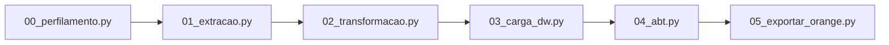

# Guia Completo e Mapa de Todos os Arquivos do Projeto
## Laboratório de ETL e Mineração de Dados — Mercatto Varejo
**Equipe:** Mateus de Souza Arruda & Lorena Strobel Campos  
**Disciplina:** Mineração de Dados (IFMT · 2026/2) — Prof. Dr. Orlando Júnior

---

## 1. Visão Geral da Arquitetura do Projeto

O projeto foi desenhado para simular um cenário real de engenharia e mineração de dados: a **Mercatto Comércio S.A.** adquiriu uma operação de e-commerce e precisa integrar **quatro fontes heterogêneas** (~2,2 milhões de registros) para prever se um cliente voltará a comprar nos próximos 90 dias.

```
.
├── docker-compose.yml              <- Orquestração dos contêineres e bancos
├── .env / .env.example             <- Variáveis de ambiente e escala
├── dados/                          <- Arquivos de entrada e CSVs de carga brutos
├── sql/                            <- DDLs de criação dos bancos de dados
│   ├── mysql/                      <- ERP Legado (latin1)
│   ├── postgres-origem/            <- E-commerce (UTF-8)
│   └── postgres-dw/                <- Data Warehouse (stg, dw, abt, qa)
├── gerador/                        <- Geração determinística dos dados sintéticos
├── etl/                            <- Pipeline de Engenharia de Dados (Python)
│   ├── config.py                   <- Conexões e parâmetros analíticos
│   ├── qualidade/assercoes.py      <- Framework de testes automatizados (QA)
│   ├── 00_perfilamento.py          <- Semana 1: Diagnóstico prévio das fontes
│   ├── 01_extracao.py              <- Semana 2: Carga bruta na Staging (stg)
│   ├── 02_transformacao.py         <- Semana 2: Limpeza, conformação e RDTs
│   ├── 03_carga_dw.py              <- Semana 3: Carga do Esquema Estrela (dw)
│   ├── 04_abt.py                   <- Semana 4: Construção da ABT e Vazamento
│   └── 05_exportar_orange.py       <- Semana 4: Formatação para o Orange Canvas
├── orange/                         <- Fluxos visuais (.ows) e gráficos de ROC/Matrizes
├── saida/                          <- Relatórios em Markdown e CSVs finais da ABT
└── docs/                           <- Documentação técnica e Registro de Decisões (RDT)
```

---

## 2. Infraestrutura e Bancos de Dados

### `docker-compose.yml`
* **O que é:** Arquivo de orquestração do Docker.
* **O que faz:** Sobe 5 serviços em contêineres isolados:
  1. `mysql_legado` (porta `3307`): Simula o ERP legado em MySQL 8, charset `latin1`.
  2. `pg_ecommerce` (porta `5433`): Simula o banco transacional de e-commerce em PostgreSQL 16, UTF-8.
  3. `pg_dw` (porta `5434`): O banco analítico (PostgreSQL 16) onde gravamos todo o nosso Data Warehouse.
  4. `adminer` (porta `8080`): Interface web no navegador para inspecionar os bancos visualmente.
  5. `etl`: Contêiner com Python 3.12 e bibliotecas (Pandas, SQLAlchemy, PyMySQL, Psycopg2) onde rodamos os scripts.
  6. `seed`: Serviço efêmero que roda o gerador determinístico na primeira inicialização.

### `sql/mysql/01_schema_legado.sql`
* **O que é:** DDL do sistema legado (`loja_legado`).
* **Estrutura:** Tabelas `CLIENTES` (com CPF mascarado e duplicatas), `PRODUTOS` (categorias em texto livre), `PEDIDOS` (com `STATUS` e `VALOR_TOTAL` com frete embutido) e `ITENS_PEDIDO`.

### `sql/postgres-origem/01_schema_ecommerce.sql`
* **O que é:** DDL da plataforma digital (`ecommerce`).
* **Estrutura:** Tabelas no esquema `shop`: `customer` (CPF sem máscara), `category` (hierarquia em 2 níveis), `product`, `orders` (com `status` detalhado e `total_amount` sem frete) e `order_item`.

### `sql/postgres-dw/01_schema_dw.sql`
* **O que é:** DDL do repositório analítico `mercatto_dw`.
* **As 4 Camadas (Esquemas):**
  * `stg`: Tabelas de triagem para receber os dados brutos e intermediários.
  * `dw`: O Esquema Estrela oficial. Contém as dimensões (`dim_cliente`, `dim_produto`, `dim_tempo`, `dim_canal`, `dim_status`) e as tabelas-fato (`fato_pedido`, `fato_item_pedido`, `fato_atendimento`, `fato_avaliacao`).
  * `abt`: Contém as tabelas para mineração de dados (`recompra_90d` e `recompra_90d_vazamento`).
  * `qa`: Contém a tabela `execucao_assercao`, que audita os testes automatizados de qualidade.

---

## 3. Os Scripts do Pipeline ETL (`etl/`)

Os scripts são executados rigorosamente em ordem numérica (`00` a `05`):



---

### `etl/config.py`
* **Função:** Centralizar as conexões e os parâmetros analíticos globais.
* **O que define:**
  * Strings de conexão (DSN) para MySQL, PostgreSQL Origem e PostgreSQL DW.
  * Caminhos dos arquivos de SAC (`dados/atendimentos_sac.csv`) e Avaliações (`dados/avaliacoes_marketplace.json`).
  * **Parâmetros Inegociáveis:** `DATA_CORTE = "2025-06-30"`, `JANELA_ALVO_DIAS = 90` e `DATA_FIM_ALVO = "2025-09-28"`.

---

### `etl/qualidade/assercoes.py`
* **Função:** Framework de governança de dados e testes unitários/integrados.
* **Classe `Suite`:** Implementa verificações formais (Princípio 6 da disciplina):
  * `qa.igual(nome, obtido, esperado)`: Testa contagens exatas.
  * `qa.sem_nulos(nome, serie)`: Garante integridade de Foreign Keys.
  * `qa.unico(nome, serie)`: Garante unicidade de chaves primárias.
  * `qa.entre(nome, valor, min, max)`: Testa intervalos (ex: reconciliação financeira $\le 0,1\%$).
  * `qa.cardinalidade_preservada(nome, antes, depois)`: Evita explosão cartesiana em joins.
  * `qa.registrar(engine)`: Persiste os resultados na tabela `qa.execucao_assercao`.

---

### `etl/00_perfilamento.py` (Semana 1)
* **Objetivo:** "Perfilar antes de tocar" (Princípio 1 da disciplina). Diagnosticar anomalias antes de escrever qualquer regra.
* **O que faz:**
  * Lê as 4 fontes de dados sem alterar nenhum valor.
  * Mede percentuais de nulos, duplicatas, formatos de data, ranges numéricos e distribuições de texto.
  * **Principais descobertas:**
    1. A armadilha do `VALOR_TOTAL` no legado (tem frete embutido) versus `total_amount` no e-commerce (sem frete).
    2. A presença de 9% de CPFs com dígito inválido propagados identicamente nos dois sistemas.
    3. As 1.025 datas sentinela `1900-01-01` e 2.458 entregas registradas antes da data do pedido.
    4. 20.577 itens órfãos sem pedido nas duas bases (exatos 1,48%).
* **Saída gerada:** Arquivos `saida/perfilamento_legado.md`, `saida/perfilamento_ecommerce.md` e `saida/perfilamento_sac.md`.

---

### `etl/01_extracao.py` (Semana 2 · Início)
* **Objetivo:** Ingestão bruta de todas as fontes para a camada de Staging (`stg`) do PostgreSQL DW.
* **Funções principais:**
  * `extrai_mysql()`: Lê em lotes de 50.000 linhas as 4 tabelas do MySQL legado (`CLIENTES`, `PRODUTOS`, `PEDIDOS`, `ITENS_PEDIDO`) com charset `latin1` e grava em `stg.legado_*`.
  * `extrai_postgres()`: Extrai as 5 tabelas da plataforma digital (`customer`, `product`, `category`, `orders`, `order_item`) e grava em `stg.ecommerce_*`.
  * `extrai_sac()`: Lê o arquivo CSV com encoding `latin-1`, delimitador `;` e vírgula decimal, gravando em `stg.sac_atendimentos`.
  * `extrai_avaliacoes()`: Lê o arquivo NDJSON em UTF-8, achata a estrutura aninhada e grava em `stg.marketplace_avaliacoes`.
* **Decisão / RDT associada:**
  * **RDT-01 (Carga Completa vs. Incremental):** Adotou-se carga completa (*Full Load*) para garantir a reprodutibilidade determinística do ambiente a partir do zero.

---

### `etl/02_transformacao.py` (Semana 2 · Núcleo Epistêmico)
* **Objetivo:** Aplicar regras de padronização, limpeza e conformação sobre a Staging, gerando as dimensões principais e tabelas intermediárias de pedidos/itens conformados.
* **Funções e RDTs correspondentes:**
  1. `unifica_clientes(qa)`:
     * **RDT-02 (Identidade por CPF):** Pareia clientes entre legado e e-commerce por CPF, **aceitando dígitos verificadores inválidos propagados**. Salvou 1.135 pareamentos legítimos em `dw.dim_cliente`. Recusou pareamento por nome/cidade para evitar falsos positivos.
     * **RDT-03 (Deduplicação do Legado):** Identificou 5.849 cadastros repetidos no legado; desempata retendo o registro com cadastro mais recente (`dt_cadastro DESC`).
  2. `conforma_status(qa)`:
     * **RDT-04 (Conformação de Status):** Unifica os status em 4 categorias (`ENTREGUE`, `EM_TRANSITO`, `PROCESSAMENTO`, `CANCELADO`) e grava em `dw.dim_status`. Cria o atributo `motivo_cancelamento` para preservar a distinção entre desistência (`canceled`) e recusa de pagamento (`payment_declined`) do e-commerce.
  3. `conforma_valores(qa)`:
     * **RDT-05 (Decomposição de Kimball em 4 Medidas):** Decompõe os valores de 410.000 pedidos em `valor_mercadoria`, `valor_frete`, `valor_desconto` e `valor_total`. Grava em `stg.pedidos_valores_conformados`.
     * **RDT-06 (Frete Negativo e Desconto -1):** Trunca frete negativo de 1.174 pedidos para `0.00` (ativando `flag_frete_negativo`); converte desconto sentinela `-1` de 4.056 itens para `0.00` (ativando `flag_desconto_sentinela`).
  4. `conforma_categorias(qa)`:
     * **RDT-07 (Taxonomia de Produtos):** Mapeia os 27 rótulos livres do legado para os 15 pares taxonômicos em 2 níveis do e-commerce. Desambigua rótulos ambíguos (`OUTROS`, `DIVERSOS`, `TV E SOM`, `informatica e games`) inspecionando o substantivo canônico da descrição do produto. Grava em `dw.dim_produto`.
  5. `trata_datas_e_ausencias(qa)`:
     * **RDT-08 (Sentinela 1900 e Inversão Temporal):** Converte 1.025 datas `1900-01-01` para `NULL` (com `flag_entrega_sem_data`) e anula 2.458 entregas anteriores ao pedido (com `flag_entrega_inconsistente`).
     * **RDT-09 (Padronização em UTC):** Converte timestamps ingênuos do legado sob `America/Sao_Paulo` para UTC, realocando 11 pedidos noturnos de 30/06 para após o corte.
  6. `liga_sac_e_avaliacoes(qa)`:
     * Audita conectividade do SAC e Marketplace na Staging.

---

### `etl/03_carga_dw.py` (Semana 3 · Carga no Esquema Estrela)
* **Objetivo:** Povoar fisicamente as tabelas-fato e complementar as dimensões do DW em PostgreSQL, garantindo integridade referencial estrita e reconciliação contábil.
* **Funções principais:**
  * `carrega_dim_tempo()`: Popula o calendário dimensional (`dw.dim_tempo`).
  * `carrega_dimensoes()`: Insere o **Cliente Sentinela `cliente_sk = -1` (`CLIENTE DESCONHECIDO`)** na `dw.dim_cliente` (**RDT-12**); carrega os canais conformados na `dw.dim_canal`; cria índices de banco.
  * `carrega_fato_pedido()`: Carrega 410.000 pedidos em `dw.fato_pedido`, amarrando chaves substitutas (SKs). Associa os 38.699 pedidos sem cliente ao sentinela `-1` (**RDT-11 e RDT-12**).
  * `carrega_fato_item()`: Cruza itens com pedidos, **descarta 20.577 itens órfãos (1,48%)** e carrega 1.371.876 itens válidos em `dw.fato_item_pedido` (**RDT-10 e RDT-11**).
  * `carrega_fatos_auxiliares()`: Deduplica o SAC (95.000 únicos em `dw.fato_atendimento`, herdando cliente pelo pedido) e resolve 40.016 avaliações mascaradas com `LEG-{id}` para `dw.fato_avaliacao` (**RDT-13**).
  * `__main__`: Executa asserções de qualidade e a **Reconciliação Financeira de Ralph Kimball**, validando desvio contábil de **0,00%** (R$ 1.026.984.164,97) no legado e no e-commerce.

---

### `etl/04_abt.py` (Semana 4 · Tabela-Base de Análise e Vazamento)
* **Objetivo:** Construir as duas versões comparativas da Tabela-Base de Análise para o experimento de *Data Leakage*.
* **Estrutura interna:**
  * `SQL_ALVO`: Define o grão da ABT (clientes reais identificados ativos até `30/06/2025`, excluindo o sentinela `-1` $\rightarrow$ **99.749 clientes**) e calcula o rótulo binário `alvo_recompra_90d` para compras válidas entre `01/07` e `28/09/2025` (**taxa de positivos: 21,77%**).
  * `monta_atributos_corretos(dw)` (**RDT-14**):
    * Aplica dupla barreira temporal estrita (`data <= 2025-06-30`) em pedidos, entregas, SAC e avaliações.
    * Constrói 12 atributos comportamentais: recência, frequência, valor monetário, ticket médio, tempo como cliente, taxa de cancelamento, prazo de entrega, categorias distintas, canal predominante, propensão online, atendimentos SAC e nota média de avaliações.
    * Imputa `0` em contagens/valores e **preserva `NaN` em médias condicionais** (7.088 prazos e 42.974 avaliações).
    * Audita 1.000 clientes contra SQL estrito com 0 divergências.
  * `monta_atributos_com_vazamento(dw)` (**RDT-15**):
    * **Vazamento Temporal Óbvio:** Remove o filtro de corte nos pedidos, gerando **recência negativa (`recencia_dias < 0`) para 43.434 clientes** (média de -72,39 dias nos recompradores).
    * **Vazamento Metodológico Sutil:** Aplica normalização Z-Score global sobre `valor_monetario_total` antes da partição treino/teste, vazando média e desvio da população futura.
  * `grava()`: Persiste em `abt.recompra_90d` (versão `--correta`) ou `abt.recompra_90d_vazamento` (versão `--vazamento`).

---

### `etl/05_exportar_orange.py` (Semana 4 · Exportador)
* **Objetivo:** Ler as duas tabelas da camada `abt` e exportar arquivos CSV formatados com o cabeçalho nativo de 3 linhas exigido pelo Orange Canvas.
* **Cabeçalho de 3 Linhas do Orange:**
  * **Linha 1 (Nomes):** `cliente_sk`, `data_corte`, `recencia_dias`, ..., `alvo_recompra_90d`.
  * **Linha 2 (Tipos):** `c` (contínuo/numérico), `d` (discreto/categórico), `s` (texto), `time` (data).
  * **Linha 3 (Papéis):** 
    * `meta`: para identificadores (`cliente_sk`, `data_corte`) — o Orange ignora no treino do modelo.
    * `class`: para a variável alvo (`alvo_recompra_90d`) — define o que o modelo vai prever.
    * *(em branco)*: para os 12 atributos preditivos (features).
* **Arquivos gerados:** `saida/abt_recompra_correta.csv` e `saida/abt_recompra_vazamento.csv`.

---

## 4. O Diretório `orange/` (Mineração e Modelos)

* **`orange/fluxo_recompra_correta.ows`:**
  * Fluxo visual no Orange Data Mining consumindo `saida/abt_recompra_correta.csv`.
  * Divide em **70% Treino (69.825 clientes) e 30% Teste (29.924 clientes)** estratificado (seed 42).
  * Treina Naive Bayes, Regressão Logística e Árvore de Decisão (*Tree*).
  * Avalia exclusivamente na partição de teste (*Test on test data*).
* **`orange/fluxo_recompra_vazamento.ows`:**
  * Fluxo idêntico com os mesmos hiperparâmetros, consumindo `saida/abt_recompra_vazamento.csv`.
* **Imagens de Evidência:**
  * `orange/comparacao_roc_correta_vs_vazamento.png`: Mostra a Curva ROC honesta ($\approx 0,53$) versus a curva com vazamento subindo quase na vertical ($\approx 0,89$).
  * `orange/matrizes_confusao_comparativas.png`: Confronta as matrizes de confusão dos três modelos nas duas versões.

---

## 5. O Diretório `docs/` (Documentação e RDT)

* **`docs/MODELO_RDT_preenchido.md`:**
  * O documento mais valioso da avaliação (**30% da nota**). Contém as 15 Fichas de Decisão de Transformação preenchidas com as 6 partes obrigatórias:
    * O que o dado mostrava (com números exatos).
    * Alternativas consideradas (com justificativa técnica).
    * Decisão tomada.
    * O que se perdeu ao tomar a decisão.
    * Registros afetados (% e número absoluto).
    * Asserção associada na suíte de testes (QA).
  * Contém a Tabela-Resumo e as respostas da Reflexão Final da disciplina.
* **`docs/DICIONARIO_DE_DADOS.md`:**
  * Metadados das tabelas de origem e do DW.
* **`docs/PROFESSOR.md`:**
  * O gabarito e guia de avaliação pedagógica do docente.

---

## 6. Tabela Rápida de Correspondência (Qual arquivo cuida de qual RDT?)

| RDT | Assunto Central | Implementado em qual arquivo? |
|---|---|---|
| **RDT-01** | Carga Completa (Full Load) na Staging | `etl/01_extracao.py` |
| **RDT-02** | Unificação de Clientes por CPF (com dígito inválido) | `etl/02_transformacao.py` (`unifica_clientes`) |
| **RDT-03** | Deduplicação interna do ERP Legado | `etl/02_transformacao.py` (`unifica_clientes`) |
| **RDT-04** | Conformação de Status e recusa de pagamento | `etl/02_transformacao.py` (`conforma_status`) |
| **RDT-05** | Decomposição contábil dos Valores (semântica frete) | `etl/02_transformacao.py` (`conforma_valores`) |
| **RDT-06** | Frete negativo e desconto sentinela `-1` | `etl/02_transformacao.py` (`conforma_valores`) |
| **RDT-07** | Taxonomia de Produtos e desambiguação léxica | `etl/02_transformacao.py` (`conforma_categorias`) |
| **RDT-08** | Sentinela 1900-01-01 e inversões temporais | `etl/02_transformacao.py` (`trata_datas_e_ausencias`) |
| **RDT-09** | Padronização temporal em UTC | `etl/02_transformacao.py` (`trata_datas_e_ausencias`) |
| **RDT-10** | Descarte dos 20.577 itens órfãos | `etl/03_carga_dw.py` (`carrega_fato_item`) |
| **RDT-11** | Grão Duplo de Kimball (`fato_pedido` e `fato_item`) | `etl/03_carga_dw.py` (`carrega_fato_pedido` e `item`) |
| **RDT-12** | Cliente Sentinela `DESCONHECIDO` (`cliente_sk = -1`) | `etl/03_carga_dw.py` (`carrega_dimensoes` e `fato_pedido`)|
| **RDT-13** | Conexão do SAC e desambiguação `LEG-` nas avaliações | `etl/03_carga_dw.py` (`carrega_fatos_auxiliares`) |
| **RDT-14** | ABT Correta e dupla trava temporal | `etl/04_abt.py` (`monta_atributos_corretos`) |
| **RDT-15** | ABT com Vazamento (temporal e Z-score) | `etl/04_abt.py` (`monta_atributos_com_vazamento`) |

